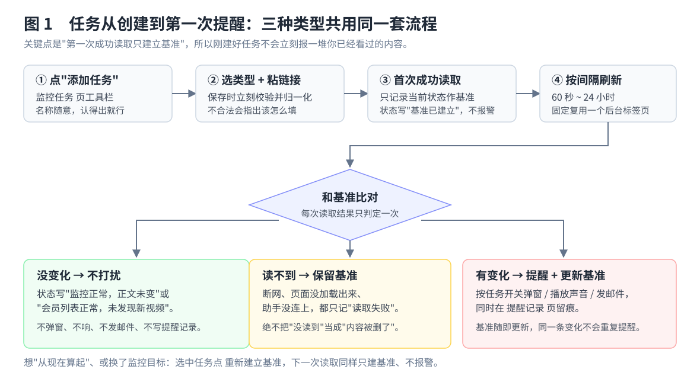
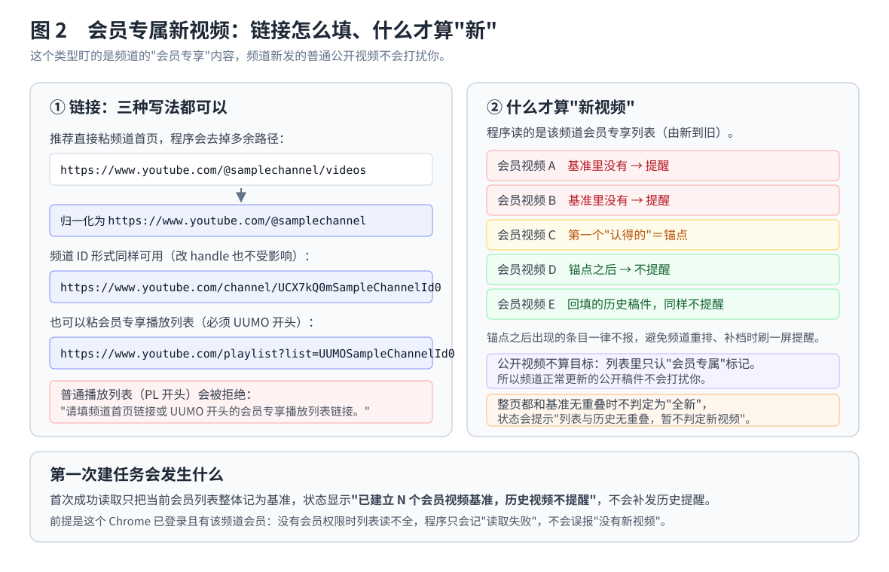
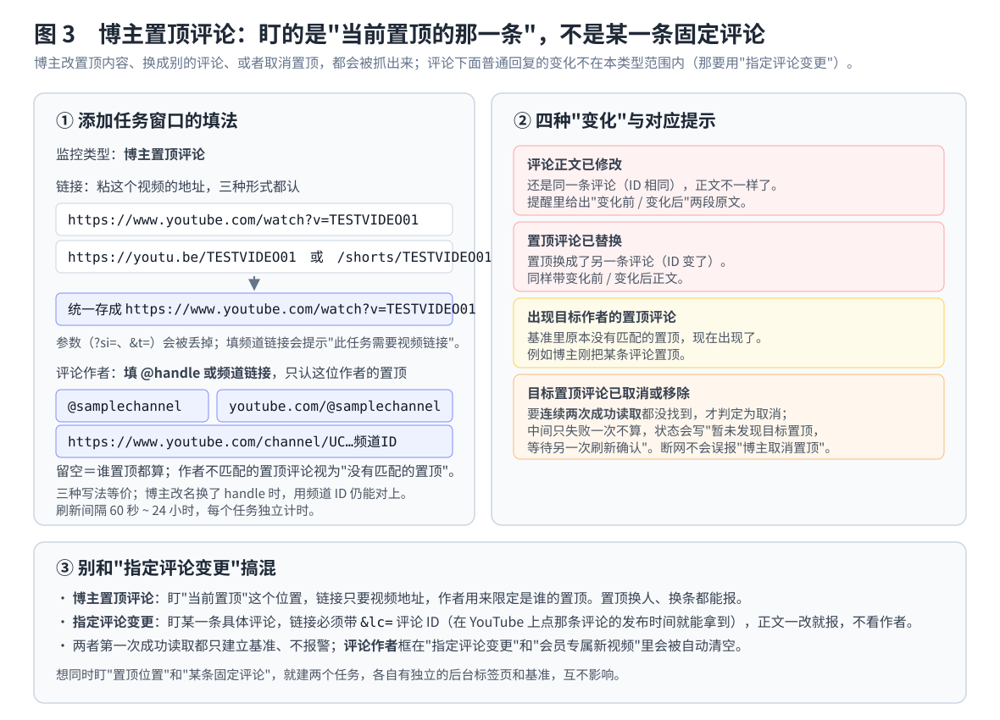

# YouTube 多任务监控面板

一个 Windows 桌面程序 + Chrome 扩展的组合工具，用你自己已经登录、且有会员权限的 Chrome 去读取 YouTube 页面，发现变化后在本机弹窗、播放本地音乐、并可选地发一封邮件给你。

它解决的是三类很具体的需求：

| 监控类型 | 盯的是什么 | 典型用法 |
| --- | --- | --- |
| 博主置顶评论 | 某个视频里指定作者（一般是博主本人）当前置顶的那条评论 | 博主改了置顶内容、换成了另一条评论、或把置顶取消了 |
| 指定评论变更 | 某一条评论的正文（用带 `&lc=` 的评论链接锁定） | 盯住一条具体回复，正文一改就通知 |
| 会员专属新视频 | 某个频道新发布的**会员专属**视频 | 频道上新了会员视频立刻提醒，公开视频不打扰 |

所有判断都在你自己的电脑上完成，不上传任何内容到第三方。

---

## 一、运行要求

- Windows 10 / 11（程序是 .NET Framework 4.x WinForms，系统自带，无需另装运行库）
- Google Chrome（或同内核的 Edge，用于加载扩展并借用你的登录状态）
- 能正常访问 YouTube 的网络环境
- 想收邮件提醒才需要一个能发 SMTP 的邮箱（163 / 126 / QQ 邮箱都可以）

> 会员视频、需要登录才能看到的评论，都依赖 Chrome 里你的登录状态。程序不会读取、也不会导出浏览器里的任何登录凭据。

---

## 二、安装：三步

### 1. 下载并运行桌面程序

从 [Releases](../../releases) 下载 `youtube-watch-monitor-<版本号>.zip`，解压到一个固定文件夹（例如 `D:\YouTubeMonitor`），双击 `PinnedWatch.exe`。

第一次运行 Windows 可能提示 "Windows 已保护你的电脑"——因为这个 exe 没有花钱做代码签名。点 **更多信息 → 仍要运行** 即可。之后可以在程序里点"创建桌面快捷方式"。

### 2. 在 Chrome 里加载扩展

- 地址栏打开 `chrome://extensions`
- 右上角打开 **开发者模式**
- 点 **加载已解压的扩展程序**，选择解压目录里的 `extension` 文件夹

### 3. 配对

- 在桌面程序切到 **连接与邮箱** 页，点 **复制配对码**
- 点 Chrome 工具栏里的拼图图标 → **YouTube 多任务监控助手**
- 把配对码粘贴进输入框 → 点 **配对 / 恢复**

配对码只需要在同一台 Windows 用户下输入一次，之后自动沿用。桌面程序 **连接与邮箱** 页显示"浏览器助手已配对"、扩展弹窗显示"助手运行中"，就说明成功了。

程序右下角有 **最小化到托盘**，可以一直开着不占地方。

---

## 三、日常使用

### 添加任务（监控任务 页）

点 **添加任务**，填这几项：

- **任务名称**：自己看得懂就行
- **监控类型**：上表三种之一
- **链接**：
  - 置顶评论 / 指定评论：粘贴视频链接（`https://www.youtube.com/watch?v=...` 或 `https://youtu.be/...` 都会自动整理）
  - 指定评论变更：最好粘贴带 `&lc=...` 的评论链接，程序会锁定那一条评论的 ID
  - 会员专属新视频：粘贴频道链接（`https://www.youtube.com/@频道名/videos` 会自动归一化）
- **评论作者**（置顶评论模式）：填 `@频道handle` 或频道链接，只有该作者的置顶评论才算目标
- **刷新间隔**：60 秒 ~ 86400 秒（24 小时），每个任务独立

按钮说明：

- **启用 / 暂停**：临时停掉某个任务，基准保留
- **重新建立基准**：换了监控目标、或者想"从现在算起"时用；之后第一次读取不报警
- **删除任务**：删除这项任务及其基准（已有的提醒记录保留）；它占用的那个后台标签页会停止刷新，可以手动关掉
- **全部立即检查**：不等间隔，立刻跑一轮

### 关于"第一次只建立基准"

任何任务第一次成功读取都**只记录当前状态、不报警**，避免把你已经看过的内容当成新变化。置顶评论"被取消"需要连续两次成功读取都确认，中途一次读取失败不算变化。

### 创建规则图解

三种类型"链接从哪来、什么才算变化"用三张图说清楚。图里的频道名、视频编号都是占位示例（`@samplechannel`、`TESTVIDEO01`），不是你自己的数据。

#### 图 1：任务从创建到第一次提醒（三种类型共用）



- 保存任务时链接立刻校验并归一化，不合法会直接告诉你该粘什么，不会存下一个跑不起来的任务。
- 第一次成功读取**只建立基准**，状态写"基准已建立"，不报警。
- 之后每次读取只有三种结果：没变化（不打扰）、读不到（记"读取失败"并保留基准）、有变化（提醒 + 更新基准）。
- "读不到"永远不等于"内容被删了"——断网、页面没加载出来、助手没连上，都不会变成提醒。
- 想"从现在算起"或换了监控目标：选中任务点 **重新建立基准**，下一次读取同样只建基准。

#### 图 2：会员专属新视频



要点：

- 链接填**频道**（`https://www.youtube.com/@频道名`，带 `/videos` 会自动去掉）、频道 ID，或 **UUMO 开头的会员专享播放列表**。普通播放列表（PL 开头）会被拒绝——那不是会员列表。
- 判定"新"用的是**锚点**：从列表顶部往下，遇到第一个已经在基准里的视频就停，只有它**上面**的新条目才提醒。频道重排列表、补发历史会员视频时不会刷一屏提醒。
- 只认"会员专属"标记，频道新发的**公开视频不算变化**，不会打扰你。
- 如果整页和基准一个都不重叠（比如你把频道换了），程序不猜"全是新视频"，状态会提示"列表与历史无重叠，暂不判定新视频"，此时检查链接或重新建立基准。
- 前提是这台 Chrome 已登录且有该频道会员，否则列表读不全，只会记"读取失败"。

#### 图 3：博主置顶评论



要点：

- 链接填**视频地址**（`watch?v=`、`youtu.be/`、`/shorts/` 都行，会统一存成 `watch?v=`，`?si=`、`&t=` 这类参数丢掉）；填频道链接会提示"此任务需要视频链接"。
- **评论作者**填 `@handle`、频道链接或 `UC…` 频道 ID，三者等价（改名换了 handle，用频道 ID 也认）。留空表示谁置顶都算。作者不匹配的置顶评论视为"没有匹配的置顶"。
- 四种变化分别是：**评论正文已修改**（同一条评论，ID 没变）、**置顶评论已替换**（换成另一条）、**出现目标作者的置顶评论**（原来没有）、**目标置顶评论已取消或移除**。前两种会在提醒里给"变化前 / 变化后"两段原文。
- 判定"取消置顶"要**连续两次成功读取**都没找到，中途一次失败不算，所以断网不会误报博主取消了置顶。
- 和"指定评论变更"的区别：本类型盯的是"当前置顶"这个**位置**；要盯某一条固定评论（比如某条官方公告回复）就用"指定评论变更"，链接必须带 `&lc=` 评论 ID——在 YouTube 上点那条评论的发布时间就能拿到带 `&lc=` 的地址。两种想同时盯，就建两个任务，各有独立标签页和基准。

### 提醒方式（音乐与提醒 页）

- **桌面弹窗**：变化发生时弹一个大窗，显示任务名、变化类型、正文，带 **打开最新目标** 按钮
- **提醒声音**（两选一）：
  - **Windows 系统提示音**：推荐，任何电脑都有，不用准备任何文件。勾上"循环播放"后会**每约 3 秒重复响一次**，直到关闭提醒弹窗或点 **停止音乐**；不勾就只响一声。
  - **播放我自己的音乐文件**：指定本机 mp3 / wav，音量可调、可循环；文件只从本机读取，不会上传

  选好后点 **试听 10 秒** 确认能听见（试听也会按"循环播放"连续响）；**测试弹窗与音乐** 用来确认弹窗和声音一起生效。
- **邮件**：**连接与邮箱 → 邮箱设置…** 只需要三样——选服务商（163 / 126 / QQ / 其他）、填你的邮箱地址、填客户端授权码。SMTP 服务器按所选服务商自动填好；收件默认就是你自己，想发到别的邮箱再勾上"提醒发到另一个邮箱"。程序用 465 端口 SSL 直连邮件服务器，不经过任何第三方服务

授权码**不是邮箱登录密码**，要先在网页邮箱里开启 SMTP/IMAP 服务生成。设置窗口会按你选的服务商写出获取入口，例如 163：登录 mail.163.com → 顶部"设置" → "POP3/SMTP/IMAP" → 开启 IMAP/SMTP 服务 → 新增授权码（需要手机验证）。

### 提醒记录 页

所有已发生的变化和读取失败都会留痕，方便回看是哪一次没读到。

- **自动上限**：记录只保留最近 500 条，超出时从最旧的开始删；还没发出邮件的条目优先保留，断网期间的待办不会被清掉。
- **清空提醒记录**：页面下方有这个按钮，点下去会先弹确认。清空只删记录，**不影响监控基准**——已经提醒过的内容不会因此重新提醒一遍。

---

## 四、换电脑：配置文件导出 / 导入

**安装与迁移** 页可以把整套设置搬去另一台电脑，最小化重复劳动。

- **导出配置…**：生成一个 `YouTube监控配置-日期时间.json`，里面是任务列表（链接、类型、作者、间隔、通知开关）、提醒设置（音乐路径——留空表示用系统提示音、音量、循环、邮件地址与 SMTP 服务器），以及可选的 **监控基准**
- **附带监控基准**：默认勾选。勾上后新电脑接着上次结果比对，不会把已经看过的内容重新报一遍；不勾就是新电脑上"首次读取只建立基准"
- **导入配置…**：在 B 电脑上选这个文件，程序会校验内容安全后替换本机任务列表并恢复基准

**配置文件里刻意不包含的东西**（换机后请各填一次）：

- 配对码：按当前 Windows 用户加密（DPAPI），换机无法解密，请在 B 电脑重新点"复制配对码 → 粘贴配对"
- 邮箱客户端授权码：同上，只在 B 电脑的"邮箱设置…"里填一次
- 扩展 ID：B 电脑重新加载扩展后自动配对

音乐文件请自己复制到 B 电脑。如果导出时记录的路径在新机器上不存在，导入时会提示并保留新机器原来的音乐设置，不会把提醒弄坏。

同一页还有 **创建桌面快捷方式 / 打开程序文件夹 / 打开数据文件夹**，以及 **开机后自动启动本程序**（写当前用户的 Run 注册表项，不碰系统服务）。

---

## 五、常见问题

**Chrome 需要一直开着吗？**
需要 Chrome 进程在运行，窗口可以最小化，页面都在后台标签页里静默加载。电脑关机、休眠或退出 Chrome 期间不会监控。想开机就恢复：勾选"开机后自动启动本程序"，并在 Chrome 设置里勾选"开机时打开"。

**会不会一直开一堆标签页？**
不会。每项任务固定复用一个自己的后台标签页，按各自间隔**刷新**，不新建。

**读取失败会误报吗？**
不会。断网、页面没加载出来、扩展没连上，都只记为"读取失败"，保留原基准；只有连续两次成功读取都确认目标消失，才判定为"取消/移除"。

**双击 exe 没反应 / 被拦截？**
先按第二节的 SmartScreen 提示放行；仍不行就确认解压路径完整（`PinnedWatch.exe` 单独拷出来是可以运行的，它不依赖额外运行库）。

**邮件发不出去？**
检查是否用了"客户端授权码"而不是登录密码、SMTP 是否已开启、465 端口是否被网络阻断。可以用"发送测试邮件"排查。

**代理/科学上网环境**
程序本身只监听 `127.0.0.1:18964`（仅本机），访问 YouTube 全部由你的 Chrome 完成，所以沿用 Chrome 的代理设置即可。

---

## 六、安全与隐私

- 本机服务只绑定 `127.0.0.1`，不对外网开放，并且要求请求来自已配对的扩展来源
- 配对码与邮箱授权码用 Windows DPAPI 按当前用户加密存储，不写进配置文件、不发送到任何网站
- 不读取、不复制浏览器 Cookie 或登录凭据；页面内容只在你本机做文本比对
- 任务链接会做校验：只接受 `https` 的 YouTube 官方域名，拒绝带账号密码、非常规端口的 URL
- 配置文件上限 2 MB、任务上限 100 项，导入时逐条校验，任何一条不合法就整包拒绝并指出第几项有问题

数据目录：`%LOCALAPPDATA%\YouTubePinnedWatch`（`settings.json`、`tasks.json`、`task-states.json`、`notices.json`）。想彻底清空，退出程序后删掉这个目录即可。

---

## 七、给开发者：自己编译与测试

源码即构建脚本，不需要 Visual Studio、不需要还原 NuGet 包。

```
build.cmd      一键编译 + 跑原生自测，全部通过才替换 PinnedWatch.exe
package.cmd    编译 + 自测 + 组装 dist\youtube-watch-monitor-<版本>\ + 生成 zip
make-zip.ps1   package.cmd 调用的压缩脚本（保证 zip 条目用正斜杠，跨平台解压正常）
```

手动编译等价于：

```
C:\Windows\Microsoft.NET\Framework64\v4.0.30319\csc.exe /nologo /target:winexe ^
  /out:PinnedWatch.exe /win32icon:icon\app.ico /resource:icon\app.ico,app.ico ^
  /reference:System.Windows.Forms.dll /reference:System.Drawing.dll ^
  /reference:System.Web.Extensions.dll /reference:System.Web.dll /reference:System.Security.dll ^
  PinnedWatch.cs MonitorCore.cs CoreTests.cs
```

测试：

```
PinnedWatch.exe --self-test        原生核心逻辑自测（结果写入 self-test-result.txt）
node test-monitor.cjs              扩展端调度、读取、内容脚本测试（需要 Node.js）
```

文件结构：

```
PinnedWatch.cs      WinForms 界面、本地 HTTP 服务、SMTP 发送、托盘与弹窗
MonitorCore.cs      任务模型、变化判定规则、状态存储、配置导出/导入
CoreTests.cs        原生自测用例
docs/img/           README 里三张任务创建规则配图（手写 SVG，纯占位示例，无真实频道或视频）
make-icon.cjs       程序图标的绘制与导出；node make-icon.cjs 重新生成下面两处图标文件
icon/app.ico        桌面程序图标（16/24/32/48/64 + 256），build.cmd 用 /win32icon 内嵌进 exe
extension/          Chrome MV3 扩展（background / content / reader / inject / popup）
extension/icons/    同一枚图标的 16 / 32 / 48 / 128 PNG，供 Chrome 工具栏与扩展页使用
VERSION             版本号；需与 extension/manifest.json、MonitorCore.cs 中的 App.Version 一致（测试会检查）
```

发布到 GitHub：

1. 新建仓库，把源码目录（不含 `*.exe`、`backups/`、`dist/`，见 `.gitignore`）推上去
2. 本地跑 `package.cmd`，得到 `dist\youtube-watch-monitor-<版本>.zip`
3. 仓库 **Releases → Create a new release**，把这个 zip 作为附件上传，正文写清版本改动
4. 提醒使用者：exe 未做代码签名，首次运行需要 SmartScreen 放行

---

## 许可

MIT，见 [LICENSE](LICENSE)。
